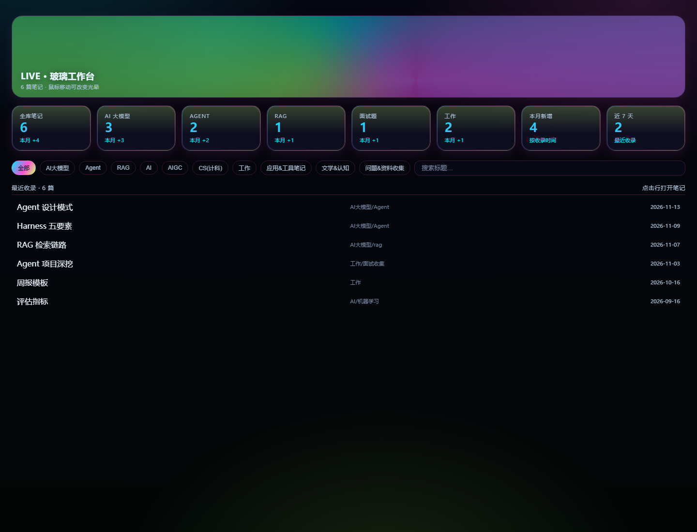
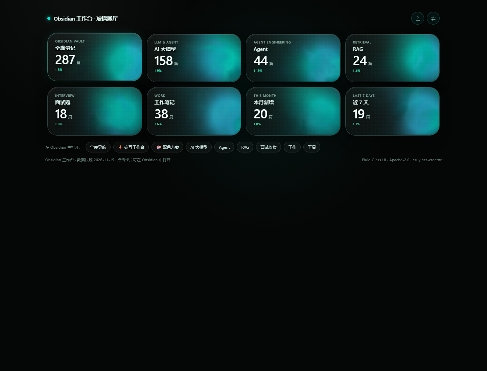

# Obsidian Glass Workbench

> 深色玻璃工作台套件：Prism Glass 设计语言 + 18 套配色 + DataviewJS 交互看板 + WebGL 玻璃展厅。

这是一个**可移植的 Obsidian 工作台模板**，从个人知识库中抽离、整理、去隐私化而来。包含：

- 🎨 **玻璃皮肤**：分层玻璃、环境光、18 套调色板、炫彩渐变、双栏、关闭配色开关
- 🌌 **静态工作台**：最近收录 / 快捷入口 / 待办 / 最近修改 / 目录概览 / 热力图
- ⚡ **交互工作台**：DataviewJS 实时指标卡 + 主题筛选 + 标题搜索 + 点击打开笔记 + CSS 极光
- 🌊 **玻璃展厅**：fluidglass-ui 的 WebGL 流体卡片，浏览器打开可点击跳回 Obsidian
- 🧭 **收录时间线**：基于 git 首次入库日期的导航页生成脚本
- 🔄 **自动同步**：Workbench Sync 本地插件在笔记实质变化后重新生成导航页 / 展厅，并刷新 Dataview（Inbox 变化不触发）

## 截图

### 交互工作台（US-22 霓虹青紫 + 炫彩渐变）



### 玻璃展厅（WebGL）



## 目录结构

```
.
├── vault-template/                  # 直接复制到 vault 的内容
│   ├── 00_系统/
│   │   ├── 工作台.md
│   │   ├── 交互工作台.md
│   │   ├── 配色方案.md
│   │   ├── 知识库导航页.md          # 占位，运行脚本生成
│   │   ├── 工作台-玻璃展厅.html
│   │   ├── 模板/玻璃展厅模板.html
│   │   └── 脚本/
│   │       ├── 生成知识库导航页.py
│   │       └── 生成玻璃展厅.py
│   └── .obsidian/
│       ├── snippets/glass-workbench.css
│       ├── plugins/workbench-sync/  # 自动同步插件
│       └── plugins-config/          # 依赖插件配置参考
├── docs/
│   ├── 安装说明.md
│   ├── 配置说明.md
│   ├── 适配指南.md
│   └── screenshots/
├── LICENSES/
├── LICENSE                          # 本套件集成代码 MIT
└── README.md
```

## 快速开始

> 详细步骤见 [docs/安装说明.md](docs/安装说明.md)。

1. 安装 Obsidian **1.15+**，主题建议 **Blue Topaz**（可选）。
2. 安装社区插件：Dataview、Homepage、Tasks、Style Settings、Keep the Rhythm、HTML Reader。
3. 把 `vault-template/00_系统/` 复制到你的 vault 根目录。
4. 把 `vault-template/.obsidian/snippets/glass-workbench.css` 复制到你的 `.obsidian/snippets/`。
5. 把 `vault-template/.obsidian/plugins/workbench-sync/` 复制到你的 `.obsidian/plugins/workbench-sync/`。
6. 重启 Obsidian，在 **设置 → 外观 → CSS 代码片段** 中启用 `glass-workbench`，在第三方插件中启用 **Workbench Sync**。
7. 设置 → Dataview → 打开 **Enable JavaScript queries**。
8. 设置 → Homepage → 主页设为 `00_系统/工作台`，打开 **Open on startup**。
9. 设置 → Workbench Sync → 填写 Python 路径（默认 `python`）。
10. 根目录运行 `python "00_系统/脚本/生成知识库导航页.py"` 和 `python "00_系统/脚本/生成玻璃展厅.py"` 生成初版。
11. 按 [docs/适配指南.md](docs/适配指南.md) 把链接、MOC 名称、`YOUR_VAULT_ID` 换成你自己的。

## 配置

全部在 **设置 → Style Settings → Prism Glass 工作台**：

| 配置 | 选项 |
|---|---|
| 配色方案 | 18 套：US-00 ~ US-25（含 4 套炫彩） |
| 炫彩渐变 | 多色环境光 / 旋转流光 / 渐变数字 / 渐变边框 |
| 玻璃模糊 | 0–40px |
| 卡片圆角 | 10–34px |
| 双栏工作台 | 阅读视图两栏 |
| 关闭背景光晕 | 性能模式 |
| 关闭玻璃模糊 | 省电模式 |
| 关闭配色（跟随主题） | 回到 Blue Topaz 原生颜色，保留玻璃结构 |

单篇笔记覆盖配色：frontmatter 写 `cssclasses: [glass-dashboard, pg-us22]`。

## 依赖

| 组件 | 版本 |
|---|---|
| Obsidian | 1.15.1（验证） |
| Dataview | 0.5.68+（需开启 JS queries） |
| Homepage | 4.6.0+（要求 Obsidian 1.13+） |
| Tasks | 7.22.0+ |
| Style Settings | 1.0.9+ |
| Keep the Rhythm | 0.2.8+ |
| HTML Reader | 1.0.13+（可选，用于打开展厅） |
| Workbench Sync | 1.1.0（本地插件，需 Python 3） |

## 已知限制

- **展厅的 WebGL 交互**在 Obsidian 的 HTML 阅读器里不保证运行；浏览器打开效果最佳。套件已在卡片和底部加入 `obsidian://` 跳转链接。
- `交互工作台` 依赖 DataviewJS；未开启时只会显示错误提示。
- 模板中的 wikilink / MOC 路径按示例知识库编写，需要按 [docs/适配指南.md](docs/适配指南.md) 调整。
- 展厅 HTML 中的 `YOUR_VAULT_ID` 必须替换为你的 vault ID（在 `%APPDATA%\obsidian\obsidian.json` 中查看）。
- **Workbench Sync 仅桌面端**，通过 `child_process` 调用 Python；需在插件设置里填写正确的 Python 路径。
- 自动同步默认**最低间隔 5 分钟**，手动「立即同步」不受限制；Inbox 的变化不触发，整理进主题目录才算。
- 未提交的新笔记会先用文件创建时间进入导航页/展厅，git 提交后切换为首次入库时间。

## 许可与致谢

- 本套件的集成代码（CSS 适配、DataviewJS、脚本、文档）：**MIT**，见 [LICENSE](LICENSE)。
- 设计语言来自 **prism-glass / 棱镜玻璃**（csuyincs-creator）：仓库 `LICENSE` 为 **Apache-2.0**（README 徽章标注 MIT，以 LICENSE 文件为准），见 [LICENSES/prism-glass-Apache-2.0.txt](LICENSES/prism-glass-Apache-2.0.txt)。
- WebGL 流体材质来自 **fluidglass-ui**（csuyincs-creator）：**Apache-2.0**，见 [LICENSES/fluidglass-Apache-2.0.txt](LICENSES/fluidglass-Apache-2.0.txt)。
- 未包含第三方品牌资产（`docs/brand/`）。

## 相关

- [prism-glass](https://github.com/csuyincs-creator/prism-glass)
- [fluidglass-ui](https://github.com/csuyincs-creator/fluidglass-ui)
